<picture>
  <source media="(prefers-color-scheme: dark)" srcset="assets/hero-dark.svg">
  
</picture>

# ai-value-assessment

The value model we use in stage 02 Assess. Explicit assumptions, three scenarios, a full cost model and reproducible arithmetic decide whether a workflow improvement earns its investment.

**FDE stage 02 · Assess** · part of the [fde-playbook](https://github.com/Unireverse-ai/fde-playbook)

[](https://github.com/Unireverse-ai/ai-value-assessment/actions/workflows/verify.yml)

**Time saved is a capacity measure. Cash saved needs a separate explanation.**

## What you get

- **A steady-state model** (`assess.py`) with conservative, base and optimistic scenarios, one-factor sensitivity and an editable offline browser calculator.
- **A monthly cash-flow model** (`cashflow.py`) for rollouts: staged adoption, scheduled implementation payments, funding gap and recovery month.
- **An evidence checklist** that names what must be measured or agreed before an assumption is relied on.

## Quickstart

Python 3.9+, standard library only.

```sh
python assess.py examples/manufacturing.json
python cashflow.py examples/staged-rollout.json
python -m unittest discover -s tests -v
```

The first command writes `artifacts/assessment.md` and `assessment.json`. Open `calculator.html` in a browser for the same model with editable inputs; it makes no network requests.

## What the sample inputs show

| Scenario | Net capacity recovered / month | Net cash benefit / month | Simple payback |
|---|---:|---:|---:|
| Conservative | 40.00 hours | −EUR 685.60 | Not reached |
| Base | 115.20 hours | EUR 277.60 | 43.23 months |
| Optimistic | 204.60 hours | EUR 1,999.68 | 6.00 months |

The base scenario has a first-year net cash benefit of −EUR 8,668.80 despite a positive monthly benefit. The model keeps unattractive results visible; released hours do not become an automatic investment recommendation.

The staged-rollout example takes the optimistic inputs with delayed adoption, early oversight and a payment schedule. It ends year one at EUR 6,063.04 net cash, with the full budget paid and a nonnegative balance from month 9 through month 12. First nonnegative cash and recovery that survives later modelled losses are reported separately.

## How the model works

```text
Eligible, adopted volume = monthly volume × eligible share × adoption
Gross handling hours released = adopted volume × (minutes before − minutes after) / 60
Net capacity hours = gross handling hours released − additional oversight hours

Gross cash reduction = gross handling hours released × loaded hourly cost × cash realization rate
Recurring cash cost = operations + model/infrastructure + additional oversight cash cost
Monthly net cash benefit = gross cash reduction − recurring cash cost
Year-one net cash benefit = 12 × monthly net cash benefit − one-time implementation cost
```

Capacity and cash are two views of the same operational change, so they are never added together. "Minutes after" excludes separately entered oversight; oversight reduces capacity in hours and adds cash cost only when it causes additional spend. The [methodology](docs/methodology.md) covers the worked example, payback and ROI definitions, and double counting.

## How we use it in an engagement

- **01 Understand** produces the baseline: workflow map, measured handling time, volumes and decision owners.
- **02 Assess** turns those measurements into the three scenarios and the evidence register for each assumption.
- Cash realization is set only where the client can name the cost line that changes; otherwise it stays at zero.
- For a pilot, `cashflow.py` models ramp, dual running and payment timing.
- Results feed the pilot brief and the acceptance thresholds used in stage 04 Evaluate.

## Contents

| Path | What it holds |
|---|---|
| [`assess.py`](assess.py) | Validation, calculations, scenarios, report output |
| [`cashflow.py`](cashflow.py) | Monthly rollout, scheduled payments, cumulative cash flow, finite-horizon recovery |
| [`calculator.html`](calculator.html) | Offline, editable browser calculator |
| [`examples/`](examples/) | Input files and the reports generated from them |
| [`docs/methodology.md`](docs/methodology.md) | Formulas, units, measurement boundaries |
| [`docs/cashflow.md`](docs/cashflow.md) | Monthly schema, payment and recovery definitions |
| [`docs/evidence-checklist.md`](docs/evidence-checklist.md) | What to measure or agree before relying on an assessment |
| [`tests/`](tests/) | Independently stated arithmetic, loss-making cases, validation, CLI checks |

## Model boundaries

- `assess.py` and the calculator apply steady-state monthly assumptions from month one; `cashflow.py` takes explicit monthly assumptions and infers no adoption curve.
- Revenue uplift, tax, financing, discounting and growth are outside the model.
- Costs are incremental cash costs of the proposed change; sunk costs are excluded.
- Scenario names label alternative assumptions, not probabilities or forecasts.
- The tool checks arithmetic and input ranges. Business evidence, technical feasibility and service quality are established in stages 01 and 04.

Calculations keep full floating-point precision internally and reports display two decimals, so figures recomputed from rounded values can differ slightly.

## Related

- Previous stage: [fde-playbook](https://github.com/Unireverse-ai/fde-playbook) (01 Understand, and the method)
- Next stage: [workflow-evals](https://github.com/Unireverse-ai/workflow-evals) (03 Build and 04 Evaluate)

---

Sample data in this repository is illustrative. Client work stays in the client's environment.

Source and documents are provided for inspection; see [RIGHTS.md](RIGHTS.md).

UniReverse · Unireverse OÜ, Tallinn, Estonia · [unireverseai.com](https://unireverseai.com) · [Eric@unireverseai.com](mailto:Eric@unireverseai.com)
